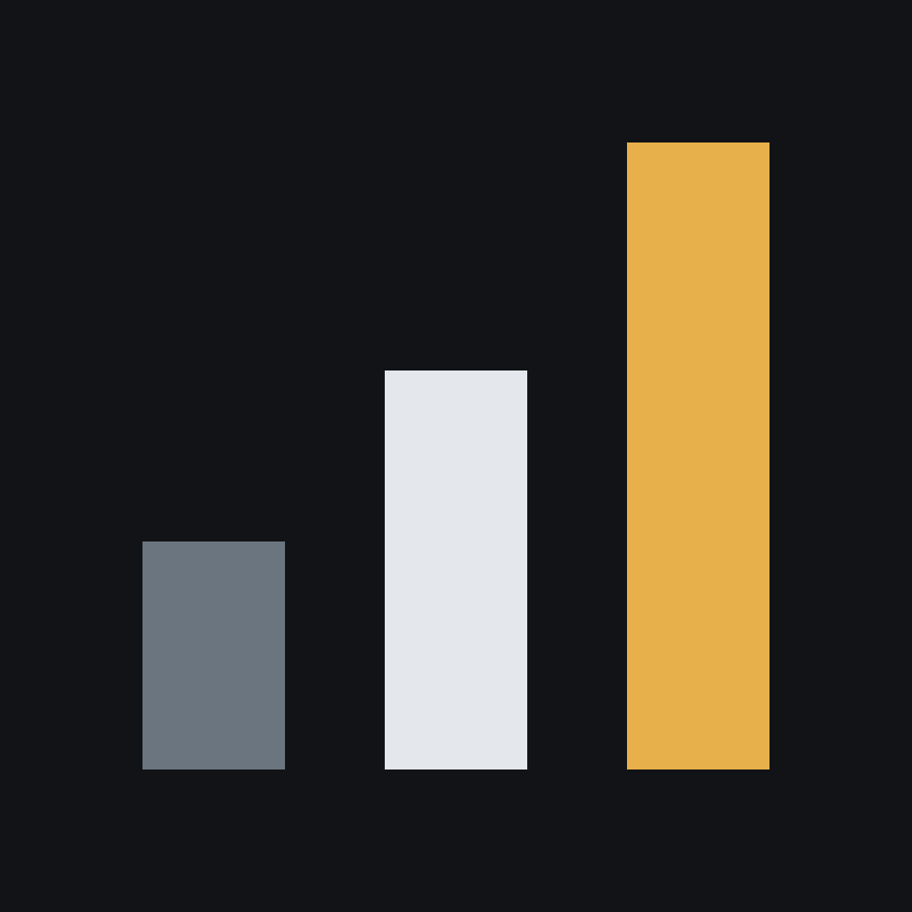

## UDeep: Ultra Deep Range

Scientific figures that record how their data became light, and use the range of modern HDR screens.

An ordinary figure stops at white and holds 256 levels. UDeep figures keep the ordinary picture for every screen,
show values above a declared threshold brighter than white on an HDR display, and carry a declaration that says
exactly how each value became light, so a reader can check the figure against its data.

- **[udeep](https://github.com/ultradeeprange/udeep)**: the UDeep Figure Profile (draft v0.3) and the reference
  tools in Python, Rust, Julia and JavaScript.
- **[Website](https://ultradeeprange.github.io/udeep/)**: real-data gallery, live view, device checks and the
  profile itself.

An independent project by Mathew Newman ([ORCID 0000-0003-1784-3250](https://orcid.org/0000-0003-1784-3250)).
Comments and device reports are welcome in the [issue tracker](https://github.com/ultradeeprange/udeep/issues).
